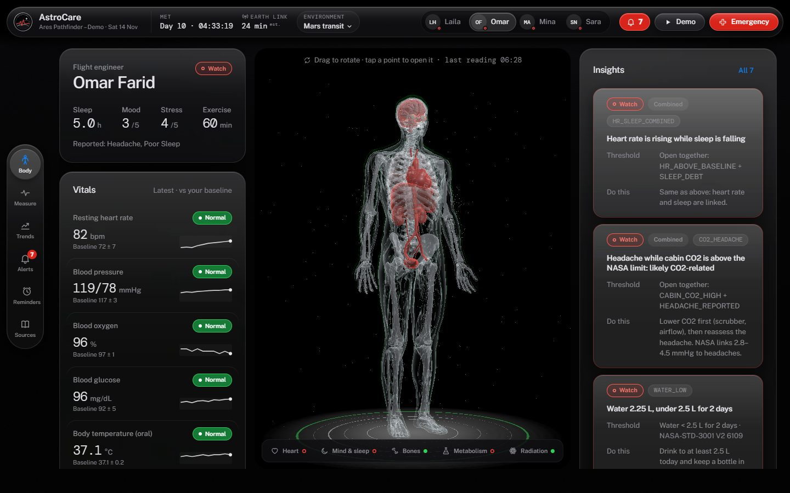
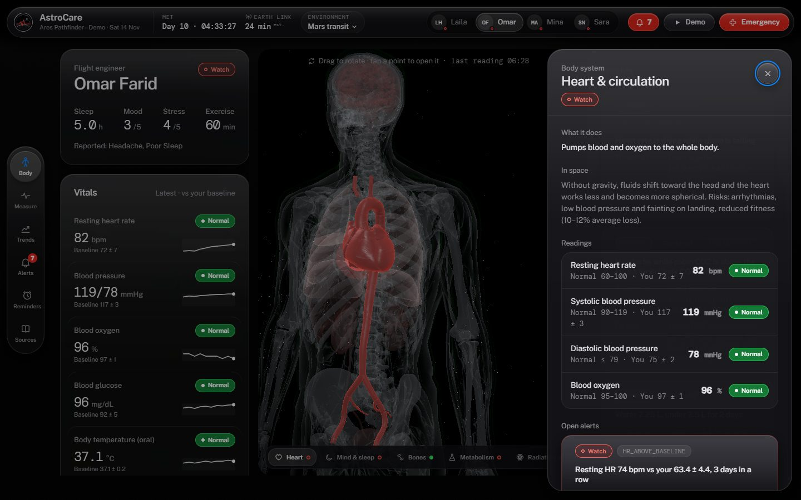
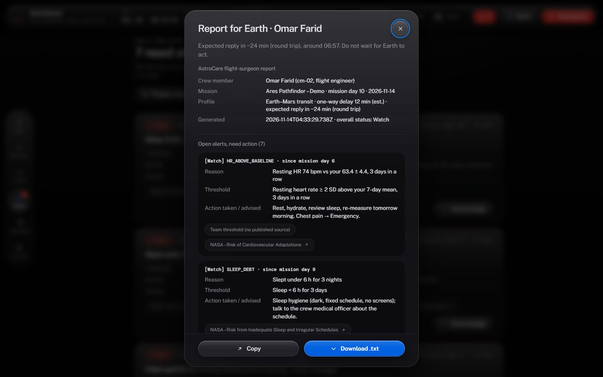
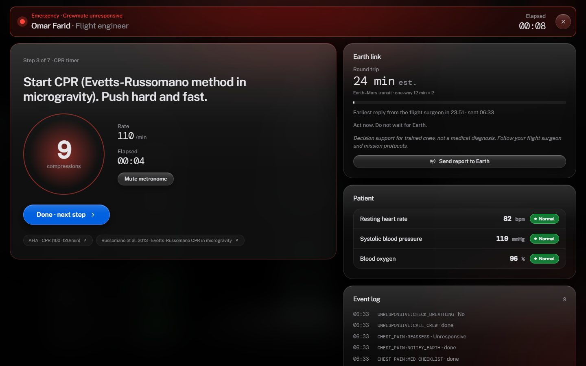
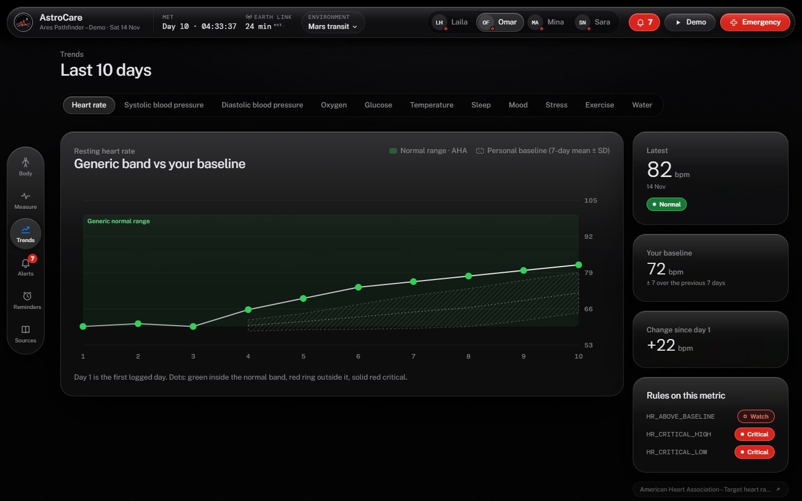
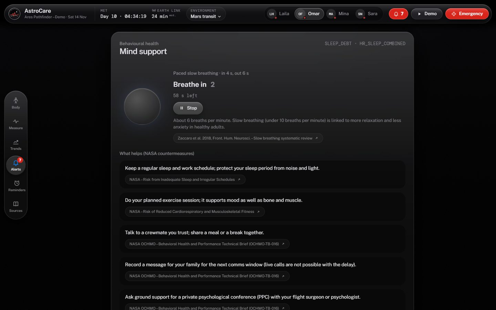

# AstroCare

**English** | [العربية](#arabic)

Crew health on long missions: personal baselines, explained alerts and guided care that keep working when Earth is 24 minutes away.

NASA Space Apps Challenge 2026 · Cairo · React + Vite, no backend. All analysis runs on the device.

| Body map (X-ray, status by organ) | Organ focus with readings and alerts |
|---|---|
|  |  |
| **Report for Earth (with the delay)** | **Emergency mode with the CPR metronome** |
|  |  |
| **Trends: your baseline vs the generic range** | **Mind support** |
|  |  |

---

## 1. The challenge

The challenge asks for software that lets astronauts gather their own health indicators, evaluate them and act, without a doctor on board.

NASA's Human Research Program groups the dangers of spaceflight into five **RIDGE** hazards:

- **R**adiation;
- **I**solation and confinement;
- **D**istance from Earth;
- **G**ravity fields;
- hostile, closed **E**nvironments.

Three facts make the problem hard:

- **Astronauts are not doctors.** They need to know how to measure, what a number means for *them*, and what to do next.
- **Earth is far away.** On a Mars transit the round trip is about 24 minutes (est.), so a flight surgeon cannot answer in real time.
- **"Normal on Earth" is not enough.** Spaceflight shifts fluids, sleep and fitness. A heart rate can stay inside Earth limits while it climbs well above the astronaut's own baseline.

## 2. Our solution

AstroCare closes the **gather → evaluate → act** loop on the device:

- **Gather:** the crew enter readings by hand, from a (simulated) smart watch or by photographing a device display. They also log a short daily check-in.
- **Evaluate:** a pure rules engine compares every value with the generic range *and* the person's own 7-day baseline. It explains each alert with the threshold and its source.
- **Act:** the app shows what to do now. That means guided steps, emergency protocols with a CPR metronome, mind support, and a report for Earth that states when the answer can arrive.

## 3. Features

| Feature | What it does | Challenge objective it answers |
|---|---|---|
| 3D anatomical body map | X-ray body built from real anatomy (BodyParts3D). Each organ takes its status colour and the heart beats at the measured rate. Click an organ to fly the camera there and open its sheet: function, effect of space, readings, alerts, NASA risks and sources. | Explain why each measurement matters |
| Guided measurement | Step-by-step cards. Manual entry is validated against `metrics.json`. A simulated watch streams heart rate and SpO₂. On-device photo OCR reads a device display, and the crew confirm every value. | Show astronauts how to measure |
| Daily check-in | Sleep, mood, stress, symptoms (red flags open Emergency mode), exercise, water and meals. | Gather all health indicators |
| Personal baseline (Trends) | Each metric against the generic normal band and the person's 7-day mean ± SD. Sleep, mood, stress, exercise and water are shown against their rules and NASA daily targets. | Evaluate the indicators |
| Rules engine | 28 rules in `rules.json` (threshold, baseline, streak and combined rules). Every alert shows its code, reason, threshold, action, severity and sources. | Say what to do when a value is abnormal |
| Emergency mode | `protocols.json` state machine (crewmate with chest pain, crewmate unresponsive). CPR timer and metronome at 110/min, a running Earth-delay counter, and an event log. | Guide the crew in an emergency |
| Report for Earth | A flight-surgeon report with open and acknowledged alerts, vitals vs baseline, check-in, cabin air, dose, emergency log and support requests. It gives the expected reply time from the mission's delay. Copy or download as `.txt`. | Act when Earth is far away |
| Mind support | One minute of paced breathing (in 4 s, out 6 s) and five NASA countermeasures with sources. A button requests a private psychological conference with ground. If mood is critical, a red line comes first. | Isolation and confinement (behavioural health) |
| Reminders | 6 daily and weekly reminders: measurements, check-in, exercise, water. | Remind the crew to measure and follow countermeasures |
| Mission environments | ISS, Moon (Artemis), Mars transit, Mars surface. The switch in the top bar changes the Earth delay, the radiation dose and the estimated bone loss everywhere. | Distance, radiation and gravity hazards |
| Offline PWA | The production build registers a service worker and runs with no network. | Works without Earth |

## 4. The demo story (Omar Farid, cm-02)

Open `http://localhost:5173/?play` to replay the 10 days automatically. The camera flies to each organ as its alert fires.

| Day | What happens | Rules |
|---|---|---|
| 1 | First readings set Omar's personal baseline. Everything is green. | none |
| 6 | Resting heart rate is still "Normal" by Earth limits, but it is the third day above his own baseline. The heart turns red (Watch). | `HR_ABOVE_BASELINE` |
| 9 | Sleep under 6 h for 3 nights, plus rising heart rate, gives a combined insight. A headache while cabin CO₂ is 3.2 mmHg (NASA limit 3) gives another. Mind support appears. | `SLEEP_DEBT`, `HR_SLEEP_COMBINED`, `CABIN_CO2_HIGH`, `HEADACHE_REPORTED`, `CO2_HEADACHE` |
| 10 | Two days under 2.5 L of water. Then a crewmate collapses with chest pain and Emergency mode starts: protocol, CPR metronome and the Earth reply delay. | `WATER_LOW` |

`npm run check:data` replays this story with the app's own rules engine and fails if any day fires a different alert.

## 5. How it meets the judging criteria

- **Impact:** the app targets the real gap on deep-space missions, where no doctor is on board and Earth answers late. Personal baselines catch changes that Earth limits miss (day 6).
- **Creativity:** an anatomical X-ray body coloured by a rules engine. A mission-environment switch that changes delay, dose and bone loss. A report for Earth that plans around the delay. Combined insights such as CO₂ plus headache.
- **Validity:**
  - Every medical number comes from `src/data` with its source: 34 sources, 17 of them NASA.
  - Estimates are marked "est." on screen, and team thresholds are labelled "Team threshold (no published source)".
  - `check:data` verifies the data and the demo.
- **Relevance:** it covers the full gather, evaluate and act loop, all five RIDGE hazards, and the NASA human system risks (10 covered, 6 partly, 15 listed as not yet).
- **Presentation:** a 10-day guided replay (`?play`) on one screen, with responsive layouts for desktop, tablet and phone, and a clear disclaimer.

## 6. Scientific grounding

- **Sources:** 34 in `src/data/sources.json`: 17 NASA, 4 CSA, 6 peer-reviewed, 6 medical guidelines (AHA, CDC, ADA, Cleveland Clinic, MedlinePlus) and 1 team entry. The full list is on the **Sources** screen.
- **NASA HRP:** the five RIDGE hazards (`hazards.json`) and 31 human system risks (`nasa-risks.json`), each with honest app coverage.
- **Cabin limits:** cabin CO₂ and O₂ limits come from NASA-STD-3001 and the OCHMO technical briefs. CPR follows AHA rates and the Evetts-Russomano method for microgravity.
- **Estimates and team thresholds:** values that are estimates (for example the Mars delay) are listed in each profile's `estimates[]` and marked **est.** in the UI. Thresholds the team set without a published source say so.
- **Verification:** every file is validated by a zod schema and cross-file integrity checks. `scripts/check-data.mjs` replays the demo against `demo-script.json`.

## 7. Architecture

```
src/
  data/            read-only seed JSON, validated (src/data/README.md)
  domain/          pure: zod schemas, integrity checks, rules engine, protocol machine, OCR text parser
  application/     ports + use cases (getCrewHealth, submitCheckIn, buildEarthReport, getMindSupport, ...)
  infrastructure/  seed loader, LocalStorage repository, simulated watch, offline digit OCR, clocks
  state/           zustand store; every change goes through a use case
  ui/              design tokens, components, shell, screens, three.js body
  app/             composition root and entry point
```

- **Layers:** dependencies point inward: `domain ← application ← infrastructure/state ← ui ← app`.
- **Pure rules engine:** `src/domain/analysis/engine.js` is the same code the browser and `check-data` run.
- **Ports:**
  - `WatchSource`: simulated today, so a real Bluetooth device can be plugged in without touching the rules;
  - `OcrEngine`: offline digit reader;
  - `HealthRepository`: LocalStorage key `astrocare:v1`, validated on load;
  - `Clock`: system clock, or a fixed one for rehearsals.
- **Stack:** React 19, Vite, three.js with @react-three/fiber and drei, zustand and zod. There is no backend and no network call at runtime.

## 8. Getting started

Requirements: Node.js 20.19 or newer (tested on Node 24) and npm.

```sh
npm install
npm run dev            # http://localhost:5173
npm run check:data     # validate src/data and replay the demo story
npm run build          # production build + offline service worker
npm run preview        # serve the build (offline mode works here, not in dev)
npm run lint
```

URL options:

- `?play` autoplays the 10-day demo;
- `?still=1` turns off the 3D idle sway.

## 9. Limitations

- The smart watch is **simulated**; the port is ready for a real device.
- The crew and readings are **demo seed data**, and dates shift so that the last seed day is today.
- The OCR reads tightly cropped printed digits only, and the crew confirm every value.
- Radiation dose, bone loss and some delays are **estimates** from the mission profile, marked "est.".
- Data stays in the browser's LocalStorage on one device and is not synced between crew devices.

## 10. Disclaimer

**Decision support for trained crew, not a medical diagnosis. Follow your flight surgeon and mission protocols.** AstroCare is an educational prototype and not a medical device.

## 11. Credits and licences

- **3D anatomy:** BodyParts3D, © The Database Center for Life Science, CC BY-SA 2.1 Japan. Details and changes are in [CREDITS.md](CREDITS.md).
- **Fonts:** Public Sans and DM Mono, self-hosted via @fontsource, SIL Open Font License 1.1.
- **Content:** NASA public resources (Human Research Program, OCHMO technical briefs, NASA-STD-3001), the Canadian Space Agency, and the peer-reviewed papers and medical guidelines listed in `src/data/sources.json`. NASA does not endorse this project.

## 12. Use of AI

AI coding assistants were used in this project: Claude (Anthropic) and, earlier, OpenAI Codex. They helped write code, data files and documentation. The team reviewed the medical content, the thresholds and every source link, and made the design and content decisions.

## 13. Team

**Lunaries**, Faculty of Computers and Informatics, Zagazig University, NASA Space Apps Cairo 2026.

<!-- TODO(team): add each member's name and role -->
- _Member name – role (to be added)_
- _Member name – role (to be added)_
- _Member name – role (to be added)_

---

<a id="arabic"></a>

<div dir="rtl">

# AstroCare

[English](#astrocare) | **العربية**

صحة الطاقم في الرحلات الطويلة: خط أساس شخصي لكل رائد، وتنبيهات مشروحة، ورعاية موجَّهة تفضل شغالة حتى لو الأرض على بُعد 24 دقيقة.

تحدي ناسا Space Apps 2026، القاهرة. التطبيق مبني بـ React + Vite من غير backend، وكل التحليل بيتم على الجهاز نفسه.

(الصور فوق في القسم الإنجليزي: خريطة الجسم، وتركيز على عضو، وتقرير الأرض، ووضع الطوارئ، والـTrends، والدعم النفسي.)

## 1. التحدي

التحدي بيطلب برنامج يخلّي رواد الفضاء يجمعوا مؤشراتهم الصحية بنفسهم، ويقيّموها، ويتصرفوا، من غير دكتور معاهم.

برنامج أبحاث الإنسان في ناسا (HRP) بيقسم مخاطر الفضاء لخمس مخاطر اسمها **RIDGE**:

- **R**: الإشعاع؛
- **I**: العزلة والحبس؛
- **D**: البُعد عن الأرض؛
- **G**: تغيّر الجاذبية؛
- **E**: بيئة مقفولة وقاسية.

المشكلة صعبة لتلات أسباب:

- **الرواد مش دكاترة.** محتاجين يعرفوا يقيسوا إزاي، والرقم ده معناه إيه بالنسبة **ليهم هم**، ويعملوا إيه بعدها.
- **الأرض بعيدة.** في رحلة المريخ الرد بياخد حوالي 24 دقيقة رايح جاي (تقدير)، فالـflight surgeon مش هيقدر يرد في نفس اللحظة.
- **"طبيعي على الأرض" مش كفاية.** الفضاء بيغيّر توزيع السوائل والنوم واللياقة. النبض ممكن يفضل جوه الحدود الطبيعية للأرض وهو طالع جامد فوق المعدل الشخصي للرائد.

## 2. الحل بتاعنا

AstroCare بيقفل الدايرة كلها على الجهاز: **يجمع ← يقيّم ← يتصرف**.

- **يجمع:** الرائد بيدخّل القراءات بإيده، أو من ساعة ذكية (محاكاة)، أو بتصوير شاشة الجهاز. وبيسجل check-in يومي قصير.
- **يقيّم:** محرك قواعد (rules engine) بيقارن كل قيمة بالمدى الطبيعي العام **وكمان** بخط الأساس الشخصي لآخر 7 أيام. وكل تنبيه بيتشرح بالحد ومصدره.
- **يتصرف:** التطبيق بيقول يعمل إيه دلوقتي: خطوات موجّهة، وبروتوكولات طوارئ مع مترونوم CPR، ودعم نفسي، وتقرير للأرض فيه إمتى الرد هيوصل.

## 3. المميزات

| الميزة | بتعمل إيه | بتحقق أنهي هدف من التحدي |
|---|---|---|
| خريطة جسم 3D تشريحية | جسم أشعة مبني من تشريح حقيقي (BodyParts3D). كل عضو بياخد لون حالته، والقلب بينبض بنفس النبض المقاس. لما تدوس على عضو الكاميرا بتروح عليه وتفتح صفحته: وظيفته، وتأثير الفضاء عليه، والقراءات، والتنبيهات، ومخاطر ناسا، والمصادر. | شرح أهمية كل قياس |
| القياس الموجَّه | كروت خطوة بخطوة. الإدخال اليدوي بيتراجع على `metrics.json`. ساعة محاكاة بتبعت النبض والأكسجين. والـOCR بيقرا شاشة الجهاز من الصورة على الجهاز نفسه، والرائد بيأكد كل قيمة. | تعليم الرواد يقيسوا إزاي |
| الـcheck-in اليومي | النوم، والمزاج، والضغط النفسي، والأعراض (الأعراض الخطيرة بتفتح الطوارئ)، والرياضة، والمية، والوجبات. | جمع كل المؤشرات |
| خط الأساس الشخصي (Trends) | كل قياس قدام المدى الطبيعي العام وقدام متوسط الرائد لآخر 7 أيام ± الانحراف. والنوم والمزاج والضغط والرياضة والمية قدام القواعد وأهداف ناسا اليومية. | تقييم المؤشرات |
| محرك القواعد | 28 قاعدة في `rules.json`: حدود، وخط أساس، وتكرار لأيام، وقواعد مجمّعة. كل تنبيه فيه الكود، والسبب، والحد، والمطلوب، والخطورة، والمصادر. | يقول يعمل إيه لما القيمة مش طبيعية |
| وضع الطوارئ | بروتوكولات من `protocols.json` (زميل عنده ألم في الصدر، أو زميل فاقد الوعي). مؤقت CPR ومترونوم 110 في الدقيقة، وعدّاد لتأخير الرد من الأرض، وسجل للأحداث. | توجيه الطاقم في الطوارئ |
| تقرير للأرض | تقرير للـflight surgeon فيه التنبيهات المفتوحة واللي اتعملها acknowledge، والقياسات قدام خط الأساس، والـcheck-in، وهوا الكابينة، والجرعة، وسجل الطوارئ، وطلبات الدعم النفسي. وفيه وقت الرد المتوقع حسب تأخير المهمة. ينفع ينسخ أو يتنزل كـ`.txt`. | التصرف والأرض بعيدة |
| الدعم النفسي (Mind support) | تمرين تنفس دقيقة (شهيق 4 ثواني وزفير 6)، و5 نصايح من ناسا بمصادرها، وزرار لطلب جلسة نفسية خاصة مع الأرض. ولو المزاج حرج بيظهر سطر أحمر في الأول. | العزلة والحبس (الصحة النفسية) |
| التذكيرات | 6 تذكيرات يومية وأسبوعية: القياسات، والـcheck-in، والرياضة، والمية. | تذكير الرواد بالقياس والإجراءات الوقائية |
| بيئات المهمة | محطة الفضاء الدولية، والقمر (Artemis)، والطريق للمريخ، وسطح المريخ. المفتاح في الشريط العلوي بيغيّر تأخير الاتصال والجرعة الإشعاعية وفقد العظم المقدّر في كل حتة. | مخاطر البُعد والإشعاع والجاذبية |
| يشتغل من غير نت (PWA) | نسخة الـbuild بتسجّل service worker وبتشتغل من غير إنترنت. | يشتغل من غير الأرض |

## 4. قصة الديمو (عمر فريد، cm-02)

افتح `http://localhost:5173/?play` والعشر أيام هيتعرضوا لوحدهم، والكاميرا بتروح على كل عضو وقت ما التنبيه بتاعه يطلع.

| اليوم | اللي بيحصل | القواعد |
|---|---|---|
| 1 | أول قراءات بتحدد خط الأساس الشخصي لعمر. كله أخضر. | مفيش |
| 6 | النبض لسه "طبيعي" بمقاييس الأرض، بس ده تالت يوم فوق معدله الشخصي. القلب بيحمر (Watch). | `HR_ABOVE_BASELINE` |
| 9 | نوم أقل من 6 ساعات لتلات ليالي مع نبض بيعلى = تنبيه مجمّع. وصداع والـCO₂ في الكابينة 3.2 mmHg (حد ناسا 3) = تنبيه مجمّع تاني. وكارت الدعم النفسي بيظهر. | `SLEEP_DEBT`، `HR_SLEEP_COMBINED`، `CABIN_CO2_HIGH`، `HEADACHE_REPORTED`، `CO2_HEADACHE` |
| 10 | يومين أقل من 2.5 لتر مية. وبعدها زميل بيقع بألم في الصدر، فبيبدأ وضع الطوارئ: البروتوكول، ومترونوم الـCPR، وتأخير رد الأرض. | `WATER_LOW` |

الأمر `npm run check:data` بيعيد تشغيل القصة دي بنفس محرك القواعد بتاع التطبيق، وبيفشل لو أي يوم طلّع تنبيه مختلف.

## 5. إزاي بيحقق معايير التحكيم

- **Impact (الأثر):** بيحل فجوة حقيقية في الرحلات البعيدة: مفيش دكتور، والأرض بترد متأخر. وخط الأساس الشخصي بيلقط تغييرات حدود الأرض مش بتشوفها (يوم 6).
- **Creativity (الإبداع):** جسم أشعة تشريحي متلوّن بمحرك قواعد، ومفتاح لبيئة المهمة بيغيّر التأخير والجرعة وفقد العظم، وتقرير للأرض محسوب على التأخير، وتنبيهات مجمّعة زي CO₂ مع صداع.
- **Validity (المصداقية):**
  - كل رقم طبي جاي من `src/data` ومعاه مصدره: 34 مصدر، منهم 17 من ناسا.
  - التقديرات مكتوب جنبها "est.".
  - الحدود اللي حطها الفريق مكتوب عليها "Team threshold (no published source)".
  - `check:data` بيتحقق من الداتا ومن الديمو.
- **Relevance (الارتباط بالتحدي):** بيغطي الدايرة كلها (يجمع، يقيّم، يتصرف)، والخمس مخاطر بتاعة RIDGE، ومخاطر ناسا على الإنسان (10 متغطية، و6 جزئياً، و15 مكتوب إنها لسه مش متغطية).
- **Presentation (العرض):** ديمو 10 أيام بيمشي لوحده (`?play`) على شاشة واحدة، وتصميم بيتظبط على الكمبيوتر والتابلت والموبايل، وجملة توضيح واضحة.

## 6. الأساس العلمي

- **المصادر:** 34 مصدر في `src/data/sources.json`: 17 ناسا، و4 وكالة الفضاء الكندية، و6 أبحاث محكّمة، و6 إرشادات طبية (AHA، CDC، ADA، Cleveland Clinic، MedlinePlus)، و1 للفريق. القايمة كاملة في شاشة **Sources**.
- **أبحاث ناسا:** مخاطر RIDGE الخمسة (`hazards.json`) و31 خطر على الإنسان من ناسا (`nasa-risks.json`)، وكل خطر مكتوب جنبه بصراحة التطبيق بيغطيه ولا لأ.
- **حدود الكابينة والـCPR:** حدود الـCO₂ والأكسجين جاية من NASA-STD-3001 ووثايق OCHMO. والـCPR ماشي بمعدلات AHA وطريقة Evetts-Russomano لانعدام الجاذبية.
- **التقديرات وحدود الفريق:** القيم التقديرية (زي تأخير المريخ) متسجلة في `estimates[]` لكل بيئة، ومكتوب جنبها **est.** في الشاشة. والحدود اللي الفريق حطها من غير مصدر منشور مكتوب عليها كده.
- **التحقق:** كل ملف بيتراجع بـzod schema ومعاه فحوصات بين الملفات. والسكريبت `scripts/check-data.mjs` بيعيد الديمو قدام `demo-script.json`.

## 7. المعمارية

- **الطبقات:** الاعتماد ماشي لجوه: `domain ← application ← infrastructure/state ← ui ← app` (شكل الفولدرات في القسم الإنجليزي).
- **محرك القواعد نقي:** `src/domain/analysis/engine.js` هو نفس الكود اللي بيشتغل في المتصفح وفي `check-data`.
- **المنافذ (Ports):**
  - `WatchSource`: محاكاة دلوقتي، وجاهز نوصّل جهاز Bluetooth حقيقي من غير ما نلمس القواعد؛
  - `OcrEngine`: قارئ أرقام من غير نت؛
  - `HealthRepository`: LocalStorage بالمفتاح `astrocare:v1`، وبيتراجع وقت التحميل؛
  - `Clock`: ساعة النظام، أو ساعة ثابتة للبروفات.
- **التقنيات:** React 19، وVite، وthree.js مع @react-three/fiber وdrei، وzustand، وzod. مفيش backend، ومفيش أي اتصال بالنت وقت التشغيل.

## 8. التشغيل

المطلوب: Node.js نسخة 20.19 أو أحدث (اتجرب على Node 24) وnpm.

```sh
npm install
npm run dev            # http://localhost:5173
npm run check:data     # يتحقق من الداتا ويعيد قصة الديمو
npm run build          # نسخة الإنتاج + service worker للتشغيل من غير نت
npm run preview        # يشغّل نسخة الـbuild (الشغل من غير نت بيبان هنا، مش في dev)
npm run lint
```

اختيارات في اللينك:

- `?play` بيشغّل ديمو العشر أيام لوحده؛
- `?still=1` بيوقّف حركة الجسم الـ3D.

## 9. الحدود (بصراحة)

- الساعة الذكية **محاكاة**، والمنفذ جاهز لجهاز حقيقي.
- الطاقم والقراءات **داتا ديمو**، والتواريخ بتتزق بحيث آخر يوم في الداتا يبقى النهارده.
- الـOCR بيقرا أرقام مطبوعة متقصوصة كويس بس، والرائد بيأكد كل قيمة.
- الجرعة الإشعاعية وفقد العظم وبعض قيم التأخير **تقديرات** من بيئة المهمة، ومكتوب جنبها "est.".
- الداتا بتتحفظ في LocalStorage على جهاز واحد، ومش بتتزامن بين أجهزة الطاقم.

## 10. توضيح مهم

**أداة مساعدة في القرار لطاقم مدرَّب، مش تشخيص طبي. اتبع الـflight surgeon وبروتوكولات المهمة.** AstroCare نموذج تعليمي ومش جهاز طبي.

## 11. الحقوق والتراخيص

- **التشريح الـ3D:** BodyParts3D، © The Database Center for Life Science، برخصة CC BY-SA 2.1 Japan. التفاصيل والتعديلات في [CREDITS.md](CREDITS.md).
- **الخطوط:** Public Sans وDM Mono، مستضافين محلياً عن طريق @fontsource، برخصة SIL Open Font License 1.1.
- **المحتوى:** موارد ناسا العامة (برنامج أبحاث الإنسان، ووثايق OCHMO، وNASA-STD-3001)، ووكالة الفضاء الكندية، والأبحاث والإرشادات الطبية اللي في `src/data/sources.json`. ناسا مش بتتبنى المشروع ده.

## 12. استخدام الذكاء الاصطناعي

استخدمنا مساعدين برمجة بالذكاء الاصطناعي في المشروع: Claude من Anthropic، وقبله OpenAI Codex. ساعدوا في كتابة الكود وملفات الداتا والتوثيق. والفريق راجع المحتوى الطبي والحدود وكل لينك مصدر، وأخد قرارات التصميم والمحتوى.

## 13. الفريق

فريق **Lunaries**، كلية الحاسبات والمعلومات، جامعة الزقازيق، NASA Space Apps Cairo 2026.

<!-- TODO(team): اكتبوا اسم كل عضو ودوره -->
- _اسم العضو – الدور (هيتضاف)_
- _اسم العضو – الدور (هيتضاف)_
- _اسم العضو – الدور (هيتضاف)_

</div>
